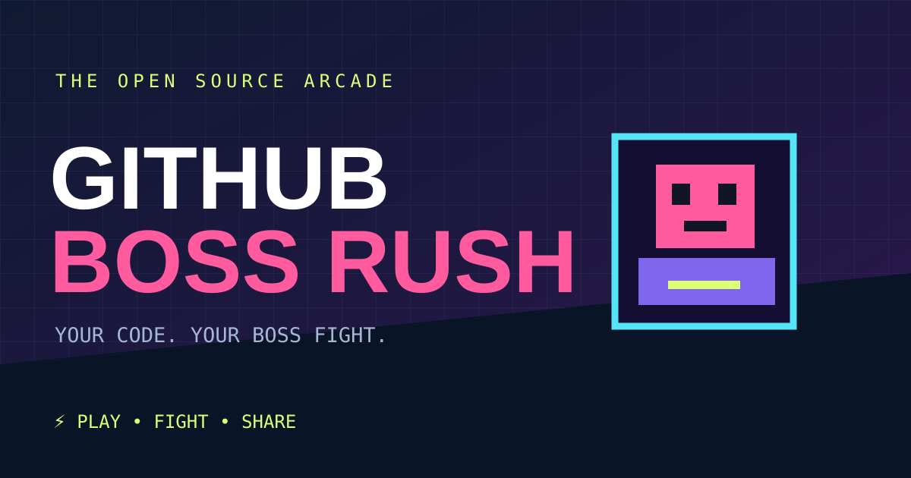

<div align="center">



# GITHUB BOSS RUSH

**Your GitHub profile. Your pixel-art boss fight.**

[**PLAY THE GAME**](https://berserk-hub150.github.io/GITHUB-BOSS-RUSH/) · [Challenge a rival](https://berserk-hub150.github.io/GITHUB-BOSS-RUSH/?hero=Berserk-hub150&boss=torvalds) · [Report an issue](https://github.com/Berserk-hub150/GITHUB-BOSS-RUSH/issues)

  

</div>

## ⚔️ What is this?

**GitHub Boss Rush** is a free, open-source, arcade-style fighting game where *public GitHub profiles* become playable fighters. Enter your GitHub username, pick a friend (or a famous developer), and settle your rivalry in 90 seconds. No registration, build steps or backend required.

- 🎮 **Real playable 1v1 combat:** move, punch, heavy attack, block, charge a special attack, and beat a basic AI.
- 📊 **Public GitHub stats:** user followers, public repo count, and stars from up to 100 recently updated repositories influence playful stats. Big accounts are deliberately compressed to keep the game balanced.
- 🎨 **Original procedural pixel-art:** game characters, neon arena, particles and synth sound effects, rendered with Canvas.
- 🔗 **Share a challenge link:** `?hero=yourname&boss=friendname` — no server required.
- 🖼️ **Export a battle card:** downloadable 1200×630 PNG (works without a backend).
- 📱 **Mobile controls:** on-screen movement and attack buttons.
- 📴 **Offline demo mode:** fallback *sample values* are visibly marked as demo data; not live stats.

> [!NOTE]
> GitHub metrics are used for entertainment, **not** to rank developer ability. The repository-star total is a sample of recent repositories, not a complete lifetime count. GitHub Boss Rush is an independent project, unaffiliated with GitHub, Inc.

## 🚀 Play

**Hosted:** https://berserk-hub150.github.io/GITHUB-BOSS-RUSH/

**Local:** clone the repo and use any static server (modules require HTTP rather than `file://`):

```bash
git clone https://github.com/Berserk-hub150/GITHUB-BOSS-RUSH.git
cd GITHUB-BOSS-RUSH
python -m http.server 8000
# Open http://localhost:8000
```

Or use VS Code Live Server. No npm install necessary.

| Key | Action |
| --- | --- |
| `A` / `D` (or arrow keys) | Move |
| `J` | Punch |
| `K` | Heavy attack |
| `L` | Special (requires 35 energy) |
| `Space` | Block |

On phones, use the on-screen buttons. Land hits to charge your special attack. Survive the 90-second timer, or knock out your rival.

## 🛠️ Architecture

```text
index.html             # Accessible UI, controls and sharing
styles.css             # Responsive retro arcade styling
src/app.mjs            # Public GitHub API, game setup, UI, sharing and PNG cards
src/game.mjs           # Original Canvas fighter, AI, effects, combat and physics
src/core.mjs           # Pure validation / stat formulas
assets/banner.svg      # Social and README banner
assets/favicon.svg     # Original icon
tests/core.test.mjs    # Node built-in tests
```

The app makes up to four public GitHub API calls per fresh matchup (two users, two repository lists), caches responses in the current browser session for ten minutes, and never requests API tokens. Anonymous GitHub requests may hit rate limits; the app explains this and offers offline demo play. Usernames are validated before constructing API requests. No private repository information is fetched, and the game has no server or analytics.

Run tests with Node 20+:

```bash
node --test tests/*.test.mjs
```

## 🌐 GitHub Pages

In your repository settings, open **Settings → Pages → Build and deployment**, select **Deploy from a branch**, choose **main** and **/(root)**, and save. Once GitHub deploys, the Play link above will work. Pages settings require a one-time owner action.

## 📣 Creator challenge

For content creators: pick your username as `boss`, send a challenge link, and invite the audience to beat your character. The project is a browser game, so anyone can play instantly. Record a 15-second clip of the duel and share the link to the original repository. Please don't imply that a creator endorses the game unless they actually do.

## Roadmap

- [ ] Video/GIF export directly from gameplay (present version exports a static PNG card)
- [ ] Local leaderboard and optional shareable replay seed
- [ ] More arena stages and playable characters
- [ ] Gamepad controls
- [ ] Better accessible non-visual alternative for the canvas arena

## 🤝 Contributing

Issues and PRs welcome: arena art, game balancing, accessibility, performance and new combat mechanics. See [CONTRIBUTING.md](CONTRIBUTING.md).

## License

MIT © Berserk-hub150. Original art and code in this repository are MIT licensed. “GitHub” and related marks are owned by GitHub, Inc.